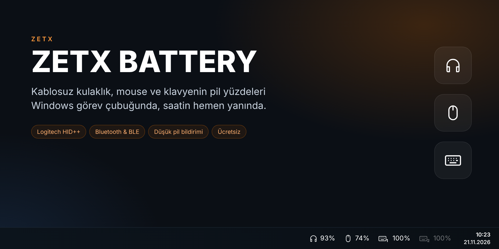

<p align="center">
  
</p>

<p align="center">
  <b>Kablosuz kulaklık, mouse ve klavyenin pil yüzdelerini Windows görev çubuğunda, saatin hemen yanında gösterir.</b><br>
  Pil azalınca bildirim gönderir. Ücretsizdir.
</p>

<p align="center">
  <a href="https://github.com/wolkansezer/zetx-battery/raw/main/indir/ZETX_BATTERY.zip"></a>
  
  <a href="https://discord.gg/nvqc84AHZf"></a>
</p>

---

## Görev çubuğunda

<p align="center"></p>

Kulaklık, mouse ve klavye simgeleri ile pil yüzdeleri, Windows saatinin solunda görev çubuğunun bir parçası gibi durur. Aynı türden birden fazla cihaz varsa (örneğin iki klavye) simgenin yanında küçük **1**, **2** numaraları görünür. Oyun veya video tam ekrandayken gösterge kendiliğinden gizlenir.

## Durumlar tek bakışta

<p align="center"></p>

| Görünüm | Anlamı |
|---|---|
| Beyaz yüzde | Normal |
| Kırmızı yüzde | Pil, belirlediğiniz eşiğin altında |
| Yeşil şimşek | Şarj oluyor |
| Soluk | Cihaz uykuda veya kapalı (son bilinen değer) |
| `--` | Cihaz bağlı ama pil bilgisi göndermiyor |

## Bildirimler

<p align="center"></p>

- Pil seçtiğiniz eşiğe (%10, %15, %20 veya %30) düşünce Windows bildirimi gelir.
- %5'te ikinci bir **kritik pil** uyarısı gelir.
- İsterseniz şarj tamamlanınca da bildirim alırsınız.
- Bildirim ekranın sağ altında açılan kendi kutusunda gösterilir; Windows bildirimleri kapalı olsa da görünür.
- Sesli uyarı veya Türkçe sesli okuma seçilebilir. Sesli okuma için Windows'ta Türkçe konuşma sesi yüklü olmalıdır (Ayarlar → Saat ve dil → Konuşma); yoksa uyarı sesi çalar.

## Ayarlar

<p align="center"></p>

Saatin yanındaki pil simgesine **sağ tıklayın**:

- **Cihazlar:** Göstergede görmek istemediğiniz cihazın işaretini kaldırın (örneğin Bluetooth'lu telefon).
- **Görev çubuğunda / Masaüstünde serbest:** Göstergenin yerini seçin.
- **Simge boyutu:** Simgeleri ve yazıları %80 ile %200 arasında büyütüp küçültün.
- **Saat ve tarihi göster:** Saati göstergeye ekler.
- **Bildirimler:** düşük pil eşiği, şarj dolunca bildir; metin olarak ekranda açılır kutu ve/veya Windows bildirimi; ses olarak uyarı sesi veya Türkçe sesli okuma; **Bildirimi test et**
- **Windows ile başlat**, **Şimdi yenile**, **Tanılama raporunu aç**

## Masaüstü modu

<p align="center"></p>

Göstergeyi görev çubuğundan çıkarıp sürükleyerek ekranda istediğiniz yere bırakabilirsiniz. Koyu arka planı açıp kapatabilirsiniz.

## Desteklenen cihazlar

<p align="center"></p>

| Marka | Cihazlar | Nasıl okunur |
|---|---|---|
| **Logitech** | Lightspeed, Unifying, Bolt alıcıları; G serisi kulaklıklar; USB/Bluetooth Logitech cihazlar | HID++ (G HUB açıksa yüzde doğrudan G HUB'dan) |
| **Razer** | Kablosuz fareler ve klavyeler (Viper, DeathAdder, Basilisk, Naga, Orochi, Cobra, Pro Click, BlackWidow V3/V4 Pro vb.) | Razer kontrol raporu (OpenRazer protokolü) |
| **Corsair** | Slipstream kablosuz fare, klavye ve kulaklıklar (Dark Core, Harpoon, Ironclaw, M75, K57, K70/K100 Wireless, HS80, Virtuoso vb.); Void ailesi kulaklıklar | Bragi protokolü / Void komutu |
| **SteelSeries** | Arctis 1/7/9/7+, Arctis Nova 3P/5/7/7P/Pro kulaklıklar; Aerox 3/5/9, Prime, Rival 3/650 fareler | SteelSeries komutları |
| **HyperX** | Cloud II Wireless, Cloud Alpha Wireless, Cloud Alpha 2 Wireless, Cloud Flight | HyperX komutları |
| **Sony** | INZONE H9 II, INZONE H5 | INZONE protokolü |
| **ASUS ROG / TUF** | Kablosuz fareler (Gladius, Keris, Harpe, Spatha, Chakram, Pugio vb.), ROG OMNI alıcısı | ASUS komutu (G-Helper'ın belgelediği) |
| **Glorious, WLmouse** | Model O / O- / D / D- Wireless, WLmouse Beast X serisi ve Sinowealth yongalı fareler | Sinowealth özellik raporu |
| **Pulsar, ATK / VXE / VGN, Kysona, LAMZU** | X2 V2, X2H, X2A, Xlite V3, VXE R1 serisi, Dragonfly, M600 ve aynı Compx/Nordic yongalı fareler | Compx protokolü (Linux hid-kysona / hid-pulsar) |
| **Tüm markalar** | Bluetooth ve Bluetooth LE ile bağlı kulaklık, mouse, klavye | Windows pil bilgisi / BLE pil servisi |
| **Diğer USB alıcılar** | Pil bilgisini standart HID raporuyla (giriş veya özellik raporu) gönderen cihazlar | Standart HID |

Protokoller [HeadsetControl](https://github.com/Sapd/HeadsetControl), [OpenRazer](https://github.com/openrazer/openrazer), [OpenLinkHub](https://github.com/jurkovic-nikola/OpenLinkHub), [rivalcfg](https://github.com/flozz/rivalcfg), [G-Helper](https://github.com/seerge/g-helper), [OpenRGB](https://gitlab.com/CalcProgrammer1/OpenRGB), [mow](https://github.com/korkje/mow) ve Linux çekirdeğinin hid-kysona sürücüsünün belgelediği komutlara dayanır.

> Not: Her üretici pil bilgisini kendi özel komutuyla verdiği için listede olmayan bir 2.4 GHz alıcının pili görünmeyebilir.

### Çalışmayan cihazı bildir

Cihazınız görünmüyorsa ya da yüzdesi yanlışsa saatin yanındaki pil simgesine sağ tıklayıp **Çalışmayan cihazı bildir...** seçeneğini kullanın (Hakkında penceresinde de bağlantısı var). Program kısa bir rapor hazırlar (Windows sürümü ve kablosuz alıcıların VID:PID kodları; kişisel bilgi içermez):

- **Discord'dan bildir:** rapor panoya kopyalanır ve [ZETX Discord sunucusu](https://discord.gg/nvqc84AHZf) açılır, yapıştırıp cihaz modelinizi yazın.
- **E-posta ile bildir:** [volkan.sezer@outlook.com.tr](mailto:volkan.sezer@outlook.com.tr) adresine rapor hazır bir e-posta açılır.

## Kurulum

1. **[ZETX_BATTERY_Kurulum.exe dosyasını indirin](https://github.com/wolkansezer/ZETX-BATTERY/releases/latest/download/ZETX_BATTERY_Kurulum.exe)** ve çalıştırın (tüm sürümler: [Releases](https://github.com/wolkansezer/ZETX-BATTERY/releases)).
2. **Kur**'a tıklayın. Yönetici izni gerekmez; program `%LOCALAPPDATA%\Programs\ZETX BATTERY` klasörüne kurulur, Başlat menüsüne ve masaüstüne kısayol eklenir.
3. Kaldırmak için: **Ayarlar → Uygulamalar → ZETX BATTERY → Kaldır**.

Kurulum istemiyorsanız taşınabilir sürüm: [ZETX_BATTERY.zip](https://github.com/wolkansezer/ZETX-BATTERY/raw/main/indir/ZETX_BATTERY.zip) (zip'i çıkarıp `ZETX BATTERY.exe` dosyasını çalıştırın).

> **SmartScreen uyarısı:** Dosyalar henüz dijital olarak imzalı değil. "Windows bilgisayarınızı korudu" uyarısında **Ek bilgi → Yine de çalıştır** seçin. Kaynak kod açık olduğu için ne yaptığını herkes inceleyebilir. İmzalama için [CODE_SIGNING.md](CODE_SIGNING.md) dosyasına bakın.

Ayarlar şu dosyada tutulur: `%APPDATA%\ZETX BATTERY\settings.json`

## Kaynak koddan derleme

Program Go ile yazıldı; tek dosya, ek kütüphane kurulumu gerektirmez.

```powershell
# Windows: Go 1.24+ kurun (https://go.dev/dl/), sonra:
git clone https://github.com/wolkansezer/ZETX-BATTERY
cd ZETX-BATTERY/src
./build.ps1        # Linux/macOS'ta: ./build.sh
```

Çıktılar `src/dist/` klasörüne yazılır. Her `main` güncellemesinde GitHub Actions da aynı derlemeyi yapar.

| Dosya | Görevi |
|---|---|
| `main.go`, `render.go` | Pencere, tepsi simgesi, menü, çizim |
| `lgmon.go`, `hidpp.go` | Logitech HID++ (Lightspeed, Unifying, Bolt, G kulaklıklar) |
| `ghub.go` | G HUB açıksa yüzdeleri G HUB'dan okur |
| `steelseries.go` | Marka protokol motoru + SteelSeries cihaz tablosu |
| `vendors.go` | Razer, Corsair, HyperX, Sony INZONE protokolleri |
| `vendors2.go` | ASUS ROG/TUF, Sinowealth (Glorious, WLmouse), Compx (Pulsar, ATK/VXE/VGN, Kysona, LAMZU) protokolleri |
| `report.go` | "Çalışmayan cihazı bildir" penceresi (Discord / e-posta) |
| `bt.go`, `devinfo.go`, `hid.go` | Bluetooth, Bluetooth LE ve standart HID pil bilgisi |
| `installer/` | Kurulum ve kaldırma programı |

SteelSeries komut tabloları [HeadsetControl](https://github.com/Sapd/HeadsetControl) ve [rivalcfg](https://github.com/flozz/rivalcfg) projelerinin belgelediği protokollere dayanır.

## Sürüm notları

**v1.4.0**
- **Bluetooth farelerde Hz düşmesi giderildi:** Bluetooth cihazlara artık sık sık doğrudan istek gönderilmiyor. Pil bilgisi Windows'un zaten tuttuğu değerden okunuyor; cihaza doğrudan soru en fazla 5 dakikada bir gidiyor (önceden Logitech Bluetooth cihazlara 2 saniyede bir, BLE pil servisine her taramada gidiyordu). Bluetooth yeniden bağlanırken oluşan art arda taramalar da sınırlandı.
- Yeni markalar: **ASUS ROG / TUF** kablosuz fareler, **Glorious** Model O/D Wireless, **WLmouse**, **Pulsar**, **ATK / VXE / VGN**, **Kysona**, **LAMZU** ve aynı Compx/Sinowealth yongalarını kullanan diğer 2.4 GHz fareler.
- Standart HID pil bilgisi artık özellik raporlarından ve "Battery System" sayfasından da okunuyor.
- Diğer markaların alıcıları 4 yerine 10 saniyede bir okunuyor (kablosuz bağlantı daha sakin).
- Yeni **Çalışmayan cihazı bildir** penceresi: rapor hazır olarak Discord'a veya e-postayla gönderilebilir.

**v1.3.0**
- Yeni markalar: **Razer** (kablosuz fare ve klavyeler), **Corsair** (Slipstream fare/klavye/kulaklıklar ve Void ailesi), **HyperX** (Cloud II Wireless, Cloud Alpha Wireless, Cloud Alpha 2 Wireless, Cloud Flight), **Sony INZONE** (H9 II, H5).
- Desteklenmeyen bir alıcı bulunduğunda tanılama raporuna cihaz kimliği yazılır.

**v1.2.1**
- Antivirüslerin yanlış alarm vermesine yol açan kalıplar kaldırıldı: PowerShell, gizli komut satırı ve "taskkill" kullanılmıyor; kısayollar, sesli okuma ve program kapatma Windows'un kendi işlevleriyle yapılıyor.
- Exe dosyalarına simge, sürüm bilgisi ve yayıncı bilgisi eklendi (GitHub Actions derlemesi).

**v1.2.0**
- Yeni bildirim sistemi: Windows bildirim ayarlarından bağımsız, ekranın sağ altında açılan bildirim kutusu.
- Sesli bildirim: uyarı sesi veya Türkçe sesli okuma ("Mouse pili yüzde 15").
- Menü → **Bildirimler**: metin (açılır kutu / Windows bildirimi) ve ses (kapalı / uyarı sesi / sesli okuma) seçimi.

**v1.1.0**
- SteelSeries desteği: Arctis 1 / 7 / 9 / 7+, Arctis Nova 3P / 5 / 7 / 7P / Pro kulaklıklar; Aerox 3 / 5 / 9, Prime, Rival 3 / 650 kablosuz fareler.
- Simge boyutu ayarı: menü → **Simge boyutu** (%80–%200); masaüstü modunda fare tekerleğiyle büyütüp küçültme.
- Kurulum programı ve Uygulamalar listesinden kaldırma.
- Kaynak kod açık (MIT lisansı).

**v1.0.4**
- G HUB açıksa pil yüzdeleri doğrudan G HUB'dan okunur; iki programda aynı değer görünür.
- G HUB kapalıyken G733 ve benzeri kulaklıklar için yeni voltaj tablosu.
- Tanılama raporu artık eski kayıtları da tutar.

**v1.0.3**
- Pil yüzdesi artık cihazın en hassas bilgisinden okunur (gerçek yüzde, yoksa voltaj, en son kaba seviye); G HUB'daki değere yaklaşır.
- Kulaklıklarda voltaj dalgalanması yumuşatıldı; ses çalarken yüzde zıplamaz.
- Şarj sırasında cihazın "uykuda" veya hatalı görünmesi düzeltildi.
- Tanılama raporuna ham pil değerleri eklendi.

**v1.0.2**
- Logitech cihazların pil yüzdesi artık 2 saniyede bir güncellenir (önceden 60 saniye).
- Şarj kablosu takılınca veya çıkarılınca şimşek simgesi anında değişir; takılı kalma hatası düzeltildi.
- Alıcı, kablo veya Bluetooth cihaz takılıp çıkarılınca tarama hemen yenilenir.
- Mouse şarj kablosuyla takılıyken alıcıdaki "uykuda" kopyası gizlenir.

**v1.0.1**
- Logitech alıcılarında mouse'un görünmemesi hatası düzeltildi.
- Uykudaki Logitech cihazlar da soluk olarak gösterilir.
- Pil bilgisi vermeyen bağlı Bluetooth klavye, mouse ve kulaklıklar `--` ile gösterilir.
- Menüye **Tanılama raporunu aç** eklendi.

**v1.0.0**
- İlk sürüm.

## İletişim

- **Sahibi:** Volkan Sezer
- **Discord:** [discord.gg/nvqc84AHZf](https://discord.gg/nvqc84AHZf)
- **Instagram:** [@zetxtv](https://instagram.com/zetxtv)
- **E-posta:** [volkan.sezer@outlook.com.tr](mailto:volkan.sezer@outlook.com.tr)
