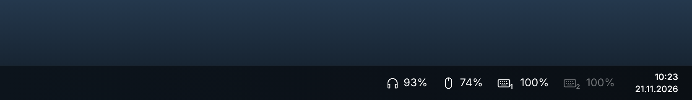
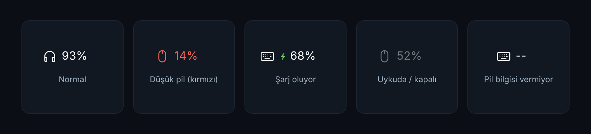
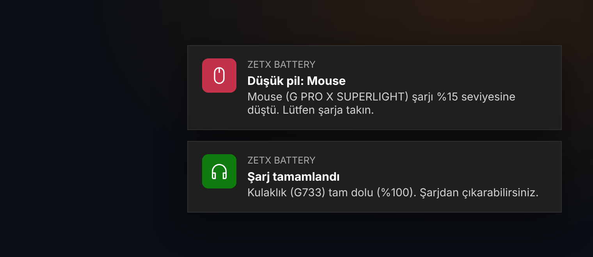
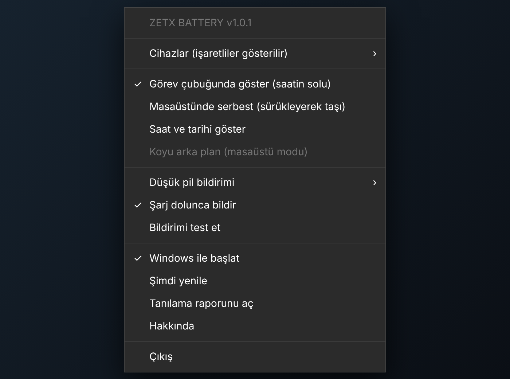
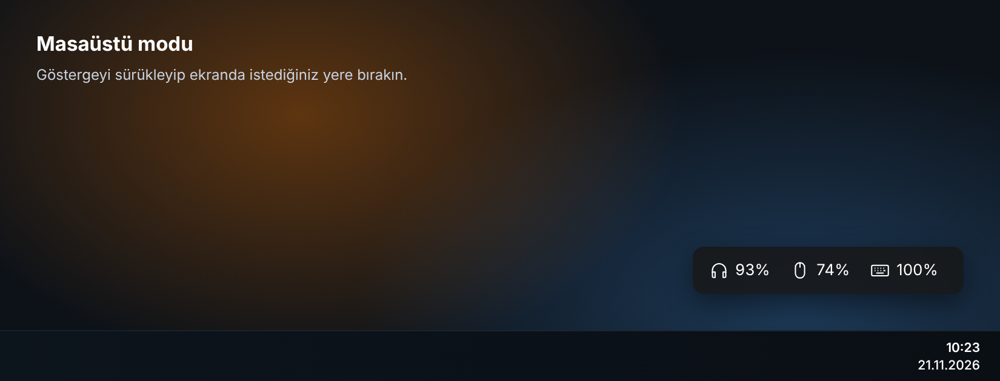
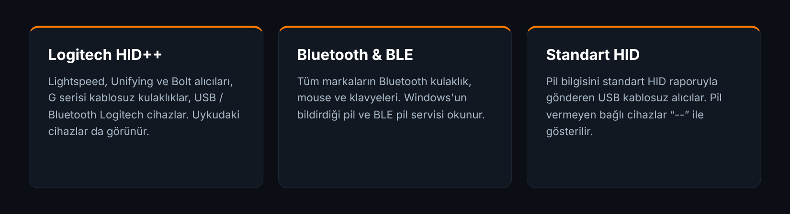

  

  <b>Kablosuz kulaklık, mouse ve klavyenin pil yüzdelerini Windows görev çubuğunda, saatin hemen yanında gösterir.</b> 
  Pil azalınca bildirim gönderir. Ücretsizdir.

  
  
  

---

## Görev çubuğunda

Kulaklık, mouse ve klavye simgeleri ile pil yüzdeleri, Windows saatinin solunda görev çubuğunun bir parçası gibi durur. Aynı türden birden fazla cihaz varsa (örneğin iki klavye) simgenin yanında küçük **1**, **2** numaraları görünür. Oyun veya video tam ekrandayken gösterge kendiliğinden gizlenir.

## Durumlar tek bakışta

| Görünüm | Anlamı |
|---|---|
| Beyaz yüzde | Normal |
| Kırmızı yüzde | Pil, belirlediğiniz eşiğin altında |
| Yeşil şimşek | Şarj oluyor |
| Soluk | Cihaz uykuda veya kapalı (son bilinen değer) |
| `--` | Cihaz bağlı ama pil bilgisi göndermiyor |

## Bildirimler

- Pil seçtiğiniz eşiğe (%10, %15, %20 veya %30) düşünce Windows bildirimi gelir.
- %5'te ikinci bir **kritik pil** uyarısı gelir.
- İsterseniz şarj tamamlanınca da bildirim alırsınız.

## Ayarlar

Saatin yanındaki pil simgesine **sağ tıklayın**:

- **Cihazlar:** Göstergede görmek istemediğiniz cihazın işaretini kaldırın (örneğin Bluetooth'lu telefon).
- **Görev çubuğunda / Masaüstünde serbest:** Göstergenin yerini seçin.
- **Saat ve tarihi göster:** Saati göstergeye ekler.
- **Düşük pil bildirimi**, **Şarj dolunca bildir**, **Bildirimi test et**
- **Windows ile başlat**, **Şimdi yenile**, **Tanılama raporunu aç**

## Masaüstü modu

Göstergeyi görev çubuğundan çıkarıp sürükleyerek ekranda istediğiniz yere bırakabilirsiniz. Koyu arka planı açıp kapatabilirsiniz.

## Desteklenen cihazlar

- **Logitech (HID++ ve G HUB):** G HUB açıksa yüzdeler birebir G HUB'dan alınır. Lightspeed, Unifying ve Bolt alıcıları, G serisi kablosuz kulaklıklar, USB veya Bluetooth ile bağlı Logitech cihazlar. G HUB açıkken de çalışır.
- **Tüm markalar, Bluetooth / Bluetooth LE:** Windows'un bildirdiği pil seviyesi ve BLE pil servisi okunur.
- **Standart HID:** Pil bilgisini standart HID raporuyla gönderen USB kablosuz alıcılar.

> Not: Razer, Corsair ve SteelSeries gibi markaların kendi USB alıcıları pil bilgisini kendi özel yöntemleriyle gönderir. Bu alıcılara bağlı cihazların pil yüzdesi görünmeyebilir. Görünmeyen bir cihazınız varsa menüden **Tanılama raporunu aç** ile raporu alıp Discord'dan gönderin.

## Kurulum

1. **[ZETX_BATTERY.zip dosyasını indirin](https://github.com/wolkansezer/zetx-battery/raw/main/indir/ZETX_BATTERY.zip)** (ya da depodaki `indir` klasöründen).
2. Zip'i bir klasöre çıkarın ve `ZETX BATTERY.exe` dosyasını çalıştırın.
3. Kurulum gerekmez. İlk açılışta program Windows ile birlikte başlayacak şekilde ayarlanır (menüden kapatılabilir).

Windows SmartScreen "Windows bilgisayarınızı korudu" uyarısı gösterirse **Ek bilgi → Yine de çalıştır** seçeneğini kullanın. Program imzasız olduğu için bu uyarı normaldir.

Ayarlar şu dosyada tutulur: `%APPDATA%\ZETX BATTERY\settings.json`

## Sürüm notları

**v1.0.4**
- G HUB açıksa pil yüzdeleri doğrudan G HUB'dan okunur; iki programda aynı değer görünür.
- G HUB kapalıyken G733 ve benzeri kulaklıklar için yeni voltaj tablosu.
- Tanılama raporu artık eski kayıtları da tutar.

**v1.0.3**
- Pil yüzdesi artık cihazın en hassas bilgisinden okunur (gerçek yüzde, yoksa voltaj, en son kaba seviye); G HUB'daki değere yaklaşır.
- Kulaklıklarda voltaj dalgalanması yumuşatıldı; ses çalarken yüzde zıplamaz.
- Şarj sırasında cihazın "uykuda" veya hatalı görünmesi düzeltildi.
- Tanılama raporuna ham pil değerleri eklendi.

**v1.0.2**
- Logitech cihazların pil yüzdesi artık 2 saniyede bir güncellenir (önceden 60 saniye).
- Şarj kablosu takılınca veya çıkarılınca şimşek simgesi anında değişir; takılı kalma hatası düzeltildi.
- Alıcı, kablo veya Bluetooth cihaz takılıp çıkarılınca tarama hemen yenilenir.
- Mouse şarj kablosuyla takılıyken alıcıdaki "uykuda" kopyası gizlenir.

**v1.0.1**
- Logitech alıcılarında mouse'un görünmemesi hatası düzeltildi.
- Uykudaki Logitech cihazlar da soluk olarak gösterilir.
- Pil bilgisi vermeyen bağlı Bluetooth klavye, mouse ve kulaklıklar `--` ile gösterilir.
- Menüye **Tanılama raporunu aç** eklendi.

**v1.0.0**
- İlk sürüm.

## İletişim

- **Sahibi:** Volkan Sezer
- **Discord:** [discord.gg/nvqc84AHZf](https://discord.gg/nvqc84AHZf)
- **Instagram:** [@zetxtv](https://instagram.com/zetxtv)
- **E-posta:** [volkan.sezer@outlook.com.tr](mailto:volkan.sezer@outlook.com.tr)
